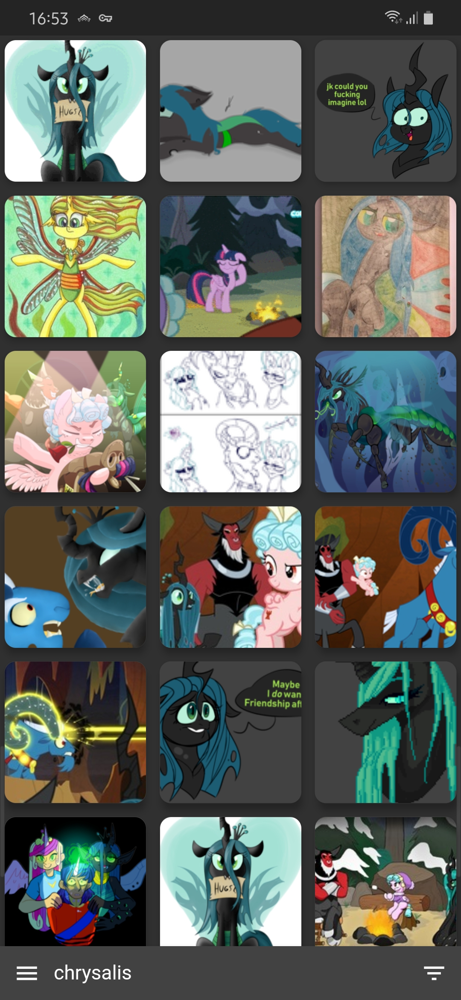
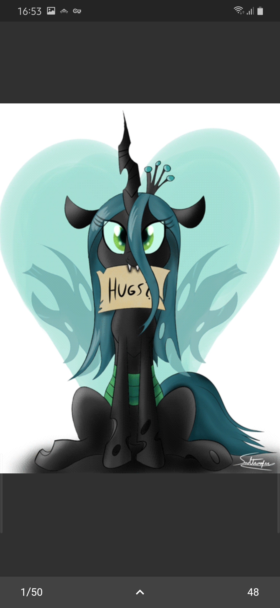
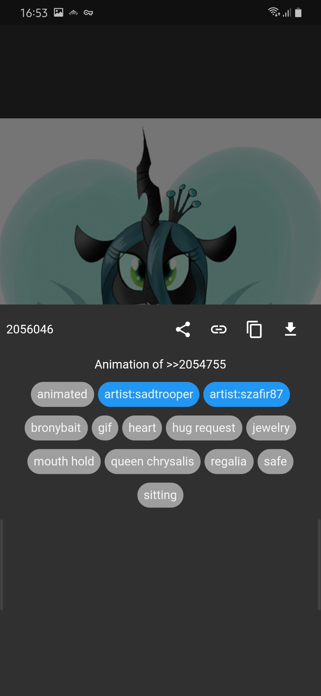
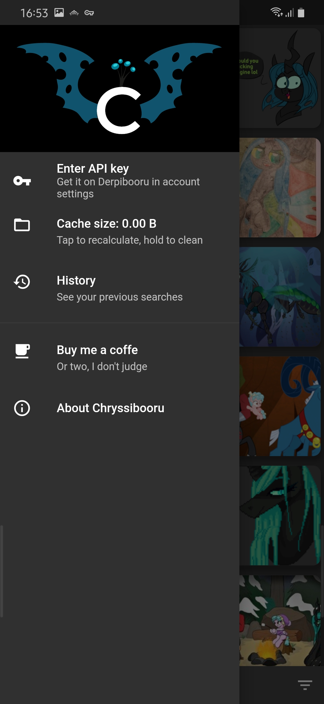

# Chryssibooru

Derpibooru client made with Flutter


## Features

* Search Derpibooru and other Philomena-based boorus by tags, with rating
  filters, sorting, image quality selection, and API keys per source
* Paginated image grid with animated WebM previews, full-screen viewer
  with pinch zoom and double-tap zoom, and video playback
* Image details with description, tags, score, and share/copy/download
* Search history and favourites, stored locally on the device
* Multiple booru sources: add Philomena-based instances by name, domain,
  API key, and API generation, and switch between them in the filter sheet

## Screenshots

| Main grid view | Full image view | Image details | App drawer |
| -------------- | --------------- | ------------- | ---------- |
|  |  |  |  |

## Known bugs

* Very recent WebM uploads have no animated `.gif` preview on Derpibooru's
  CDN, so those grid tiles show the app logo instead of a preview. Older
  WebMs still show their animated preview, as before.
* An error screen might sometimes flash briefly when swiping between video
  files. It soon disappears, though, and the video loads fine. Happens only
  on slower devices or when loading large files.

## Development

The application targets a current stable Flutter toolchain.

* **Flutter 3.50.x** (Dart 3.14.x, included in the Flutter bundle)
* Material design from the decoupled **material_ui** package (Material 3)
* Android: **Gradle 9.9.1**, **AGP 9.3.1**, **Kotlin 2.4**, compile/target SDK from
  the Flutter defaults, minSdk from the Flutter defaults
* iOS: deployment target **iOS 15**
* Windows: CMake 3.14+ (runner from the current Flutter template)
* macOS: runner from the current Flutter template
* Linux: CMake 3.14+ (runner from the current Flutter template)

### Commands

```sh
flutter pub get          # fetch dependencies
flutter analyze          # static analysis
flutter test             # unit and widget tests (no network or API key needed)
flutter run              # run on a connected device
flutter build apk --debug  # Android debug build
dart format lib test     # format
```

Local builds can embed the build date shown in the About dialog with:

```sh
flutter build apk --release --dart-define=BUILD_DATE=$(date -u +%Y-%m-%d)
```

App icons are generated from `assets/logo-xlarge-sq.png` with:

```sh
dart run flutter_launcher_icons
```

## Changelog

<!-- Release notes for GitHub releases are the newest changelog entry
     between the release-notes markers below. Move both markers down when
     adding a new entry. -->
<!-- release-notes:start -->
* **13.11.2026**
  * Added booru sources: a drawer entry opens a management screen where
    additional Philomena-based boorus can be configured by name, domain,
    API key, and API generation (Philomena V1 / V3, e.g. Twibooru); the
    active source is picked in the filter sheet when more than one source
    is configured, and queries, media URLs, and image details adapt to
    each source's URL shapes
  * Replaced the search text field with the Material 3 search bar in the
    bottom bar; taps anywhere dismiss the keyboard without triggering
    the content underneath
  * The launch screen shows the app logo on the app's dark surface
    colour instead of a white flashbang, and the About dialog includes
    the build date
  * The release workflow now also builds macOS and Linux bundles
    alongside the Android, Windows, and iOS artifacts
  * Slideshow zooming and swiping reworked after the Kemoshow-XP
    approach: pinching no longer triggers page swipes, zoomed images pan
    across the whole screen, and double-tap toggles the zoom level
  * Info sheet: proper padding and touch targets, readable tag pills,
    tag actions update the searchbar text and land in the history, and
    the slideshow position resets to the first image of the new search
  * Added booru sources: a drawer entry opens a management screen where
    additional Philomena-based boorus can be configured by name, domain,
    API key, and API generation (Philomena V1 / V3); the active source is
    picked in the filter sheet when more than one source is configured,
    and the searchbar follows query changes made through tag actions
  * The launch screen now shows the app logo on the app's dark surface
    colour instead of a white flashbang, and the About dialog includes
    the build date
<!-- release-notes:end -->

* **12.11.2026**
  * Modernized the whole codebase: null-safe Dart on Flutter 3.47 / Dart 3.13
  * Migrated to Flutter 3.50 / Dart 3.14 and the decoupled `material_ui`
    library with Material 3 styling
  * Replaced dead and abandoned packages: `flutter_advanced_networkimage` →
    `cached_network_image`, `share` → `share_plus`, `image_downloader` →
    `http` + `gal`, `package_info` → `package_info_plus`
  * Reworked pagination: concurrent duplicate requests are ignored,
    duplicate results are filtered by image id, stale responses after a new
    search are discarded, network errors are visible and retryable
  * Search query building rewritten with proper URL encoding; empty API
    keys are no longer sent
  * Downloads now report success or failure with a snackbar
  * Image zoom re-implemented with `InteractiveViewer` (pinch to zoom,
    double-tap still resets); zooming no longer swipes between images
  * Videos pause when navigating away or backgrounding the app; failed
    video loads show a message instead of an error screen
  * Search history and favourites no longer crash when empty
  * Modernized the Android, iOS, and Windows runners to the current
    Flutter templates while keeping the application identifier, icons, and
    splash screen
  * Added regression tests for parsing, query building, pagination
    behaviour, and the main screens
  * UX fixes from testing: the search bar now stays above the keyboard,
    grid pagination triggers reliably on reaching the end (and shows a
    notice when a page load fails), a loading indicator is shown while a
    search or the next page is loading, and images in the slideshow view
    appear instantly instead of fading in

* **09.11.2020**
  * Fixed history and faves not updating the search query
  * Fixed changing sorting method not refreshing the search
  * Added some simple debug info

* **08.11.2020**
  * Fixed videos not working
  * Added comment count, fave count, upvotes, downvotes, and overall score to the details panel
  * Details panel now opens by tapping the up arrow instead of swiping, to not conflict with gestures
  * Removed the V1 API files
  * Added rudimentary sorting options
  * Fixed header image not randomizing
  
* **06.11.2020**
  * Updated dependencies
  * Fixed app icon not working

* **05.11.2020**
  * Updated to work with the new Derpibooru API

* **17.12.2019**
  * Updated to use AndroidX
  * Updated Flutter to 1.12.13
  * Updated Dart to 7.2.0

* **12.12.2019**
  * Changed the "about" popup slightly

* **27.11.2019**
  * Fixed video playing in the background when scrolled to another image
  * Added image zoom – pinch out to zoom, double-tap to reset
  * Added image quality selection in the filter sheet
  * Added random Chryssi in the header

* **04.09.2019**
  * Added favourites list
  * Made history and favourites dismissable
  * Added video progress bar
  * If a video is playing, all other videos will autostart, if a video
  is paused, all other videos will be paused as well
  * Rating filter is now saved on change

* **02.06.2019**
  * Webm files now show their gif thumbnail previews in grid view!
  * Webm files in the big view *kinda* work now!

* **31.05.2019**
  * Search history now refreshes properly
  * Tapping a tag now lets you add it to your current search, remove it, or search it solo

* **30.05.2019**
  * Added search history
  * Added application info
  * Fixed filter sheet not updating
  * Fixed image download

* **29.05.2019**
  * Replaced `CachedNetworkImage` with `AdvancedNetworkImage`
  * Added image cache cleanup
  * Added progress bar for image loading
  * Share button works
  * Copy button works
  * Open in browser button works

* **28.05.2019**
  * Added Gallery view to view full images
  * Added tag list, description, score, the whole shebang
  
* **26.05.2019**
  * Grid of images now properly loads further pages
  * API key input moved to app drawer
  * Yeah, there's an app drawer now! Fancy that!
  
* **04.05.2019**
  * Modified the logo to look better
  
* **03.05.2019**
  * Added the logo image
  * Images from the 1st page display properly
  * Searching by tags and ratings works
  * Added support for the API key to allow for browsing of NSFW images

* **13.12.2018**
  * Main layout created
  
* **12.12.2018**
  * Initial commit
